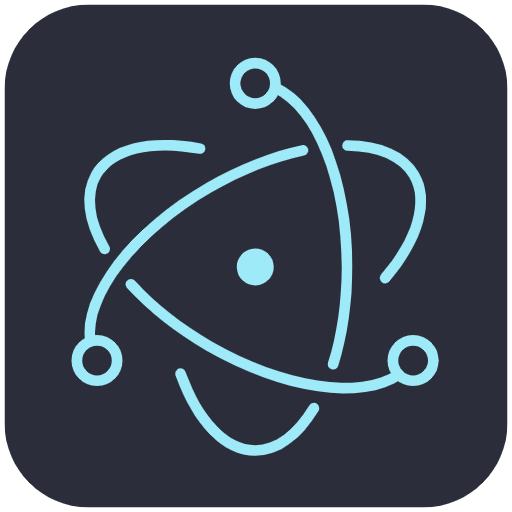
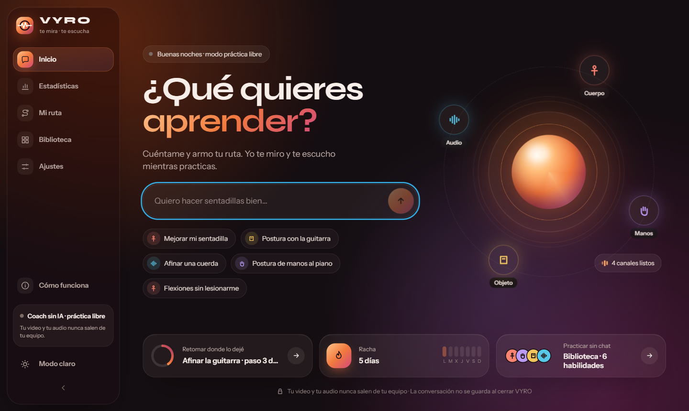
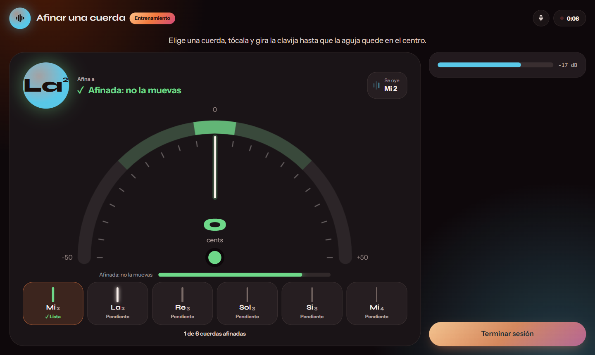
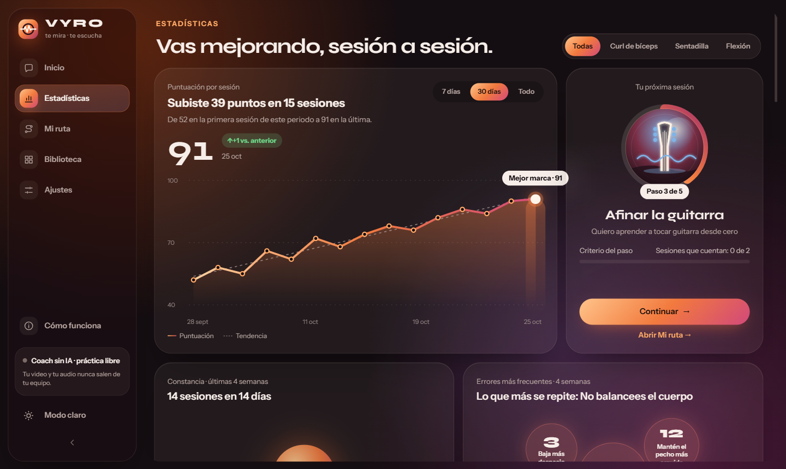
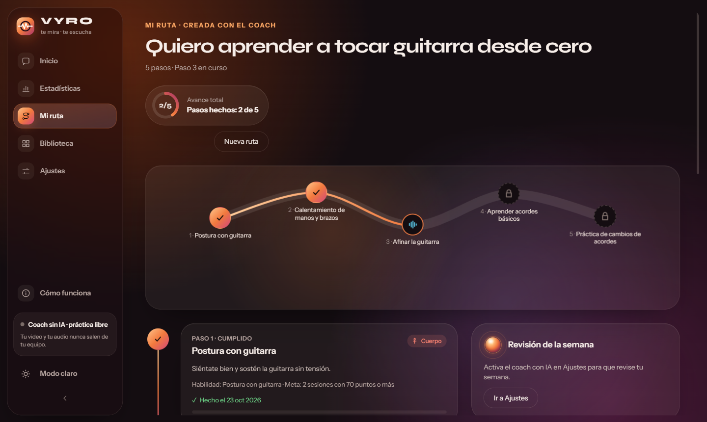
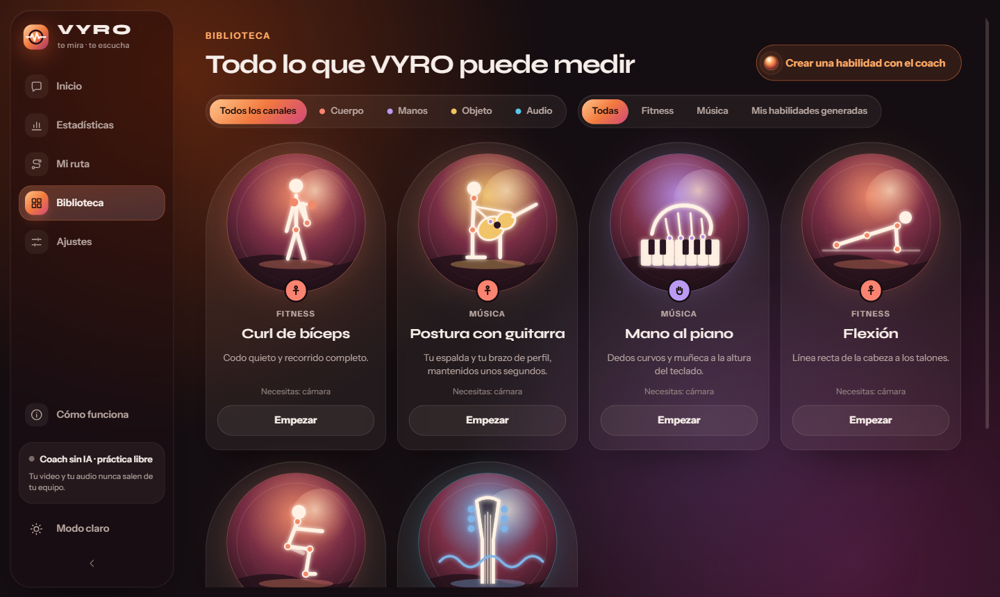

<div align="center">



# VYRO

**It sees you. It listens. It coaches you.**

A desktop coach that watches how you practise a skill through your camera and microphone,
corrects your technique out loud as you go, and tracks your progress.
**Everything runs on your computer.**

[](https://github.com/Fabiann1809/vyro/actions/workflows/ci.yml)
[](LICENSE)


**English** · [Español](README.es.md)

<br />



</div>

<br />

## What is VYRO?

Learning a skill alone, with nobody to correct you, is slow and easy to get wrong. VYRO is that
missing coach. It follows your **body**, your **hands**, an **object** (such as a guitar) or the
**sound** you make, and tells you what to fix while you are still doing it.

It does not guess about things it cannot measure. If a skill is too fine for a webcam, such as a
letter in a sign language or the exact fingering of a chord, VYRO says so instead of pretending.

## Highlights

|                                    |                                                                                                                                                   |
| ---------------------------------- | ------------------------------------------------------------------------------------------------------------------------------------------------- |
| **Sees and counts**                | Follows your pose with a neural network and counts every complete repetition.                                                                     |
| **Corrects out loud**              | One short message at a time, on screen and spoken, in Spanish or English.                                                                         |
| **Listens too**                    | Tunes each string of a guitar on a dial and recognises the instrument you play.                                                                   |
| **Sets you up first**              | A calibration checks that you are in view, at a good distance and well lit before it starts.                                                      |
| **Plans a path**                   | Tell the coach what you want to learn; it proposes steps and marks the ones VYRO can measure.                                                     |
| **Shows your progress**            | A summary after each session and a dashboard with your streak, your scores, what fails most and how each channel is doing.                        |
| **Private by design**              | No account, no cloud. Video, images and audio are never saved or sent: only numbers.                                                              |
| **Open to new skills**             | A skill is one JSON file. The engine knows no specific exercise, and the AI coach can design new ones.                                            |

## See it

<table>
  <tr>
    <td width="50%"></td>
    <td width="50%"></td>
  </tr>
  <tr>
    <td align="center"><b>Tune a string</b><br />Which string, which way to turn the peg, and when it is done.</td>
    <td align="center"><b>See your progress</b><br />Your score, your streak and the mistakes that repeat.</td>
  </tr>
  <tr>
    <td width="50%"></td>
    <td width="50%"></td>
  </tr>
  <tr>
    <td align="center"><b>Follow a path</b><br />From "I want to learn guitar" to steps you can practise.</td>
    <td align="center"><b>Pick a skill</b><br />Filter by what VYRO uses to measure it.</td>
  </tr>
</table>

## Skills that come with VYRO

| Skill                | Measured with           | What it checks                                             |
| -------------------- | ----------------------- | ---------------------------------------------------------- |
| **Squat**            | Body                    | Depth, torso lean and a controlled descent.                |
| **Push-up**          | Body                    | A straight line from head to heels and a full range.       |
| **Bicep curl**       | Body                    | A still elbow, full range and a controlled lowering.       |
| **Guitar posture**   | Body and object         | Back, arm and the guitar held steady for a few seconds.   |
| **Piano hand**       | Hands                   | Curved fingers and a wrist at the height of the keyboard. |
| **Tune a string**    | Sound                   | Six strings on a dial, until each one is in tune.         |

You can add more by asking the coach (see _Optional AI coach_) or by writing a JSON file.

## How it works

```
 camera ──► pose, hands, objects ──┐
                                   ├──► metrics ──► phases ──► repetitions ──► rules ──► feedback
 microphone ──► pitch, pace, sound ┘                                                     (screen + voice)
```

Four neural networks run **on your computer** and are always on: pose (MediaPipe), hands
(MediaPipe), objects and instrument recognition by sound (YAMNet). Everything that follows is plain
code that reads a skill's configuration: angles, distances and sounds become metrics, the metrics
decide in which phase a repetition is, and the rules judge it.

## Install

Download the file for your system from the [Releases](../../releases) page.

| System  | File                                                             | First launch                                     |
| ------- | ---------------------------------------------------------------- | ------------------------------------------------ |
| Windows | `vyro-<version>-setup.exe`                                       | Run it. See the SmartScreen note below.          |
| macOS   | `vyro-<version>-arm64.dmg` (Apple Silicon) or `-x64.dmg` (Intel) | Drag VYRO to Applications. See the note below.   |
| Linux   | `vyro-<version>.AppImage`                                        | `chmod +x vyro-*.AppImage`, then run it.         |

### The installers are not signed

VYRO is a free project and does not pay for code-signing certificates yet, so your system will warn
you the first time:

- **Windows:** SmartScreen says "Windows protected your PC". Choose **More info**, then **Run
  anyway**.
- **macOS:** it says the app cannot be opened. **Right-click** (or Control-click) VYRO in
  Applications, choose **Open**, and confirm. If macOS still refuses, run
  `xattr -cr /Applications/VYRO.app` in a terminal.

If you prefer not to trust an unsigned binary, build it yourself (see _Development_).

## First session

1. Open VYRO. Tell the coach what you want to learn, or pick a skill in the Library.
2. Allow the camera (and the microphone, for skills that listen) when your system asks.
3. For a body skill, place the camera **to your side**, 2–3 metres away, so that your whole body is
   in view. If your laptop camera cannot do that,
   [use your phone as a webcam](docs/PHONE_AS_WEBCAM.md) (the guide is in Spanish).
4. Follow the on-screen instruction until all checks are green. A 3-2-1 countdown starts the
   session by itself.

> VYRO helps you improve your technique, but it does not replace a health or training
> professional. If you feel pain, dizziness or discomfort, stop. Train in a free and safe space.

## Your data

VYRO stores **only numbers** on your computer: the repetitions, score and mistakes of each
session, and your settings. It never stores video, images, body landmarks or sound, and it sends
nothing anywhere unless you turn on the optional AI coach (see below). You can erase everything in
**Settings → Data and privacy**.

The microphone is used only in skills that listen (such as tuning a string), and only while they
are open. The sound is measured on the spot and forgotten: it is never recorded, saved or sent.

The database is a single file, `vyro.db`, in the app's data folder:

- Windows: `%APPDATA%\vyro`
- macOS: `~/Library/Application Support/vyro`
- Linux: `~/.config/vyro`

## Optional AI coach

On top of the networks that always run, VYRO can talk to a language model to chat about your
training, plan a learning path, review your week and design new skills. It is **off by default** and
needs your own API key (or a free tier, or a model on your own computer). Without it, VYRO works
exactly as described above. Only text you type and numbers from your sessions are ever sent: never
video, images, body points or sound. See the [AI guide](docs/AI_GUIDE.md).

## Development

Requirements: Node 24 and pnpm 12.

```sh
pnpm install
pnpm dev          # run the app with hot reload
pnpm lint         # ESLint
pnpm typecheck    # TypeScript (strict)
pnpm test         # unit tests (Vitest)
pnpm build        # compile the app
pnpm test:e2e     # Playwright end-to-end tests (needs `pnpm build` first)
pnpm package      # build the installer for your system, in dist/
```

The camera cannot be tested in CI, so anything that needs it is checked by hand.

### How it is organised

```
src/main/       Electron main process: window, SQLite (node:sqlite), IPC handlers
src/preload/    The only bridge between the main process and the page (typed)
src/renderer/
  core/         camera, pose detection, geometry, smoothing, framing checks (plain TypeScript)
  engine/       skill loader, phases, repetition counter, rules, feedback (plain TypeScript)
  skills/       one JSON file per skill: thresholds and messages live here, not in code
  voice/        speech and recorded fallback clips
  i18n/         es.json and en.json
  ui/           React screens and components
src/shared/     types shared by the three layers
```

### Adding a skill

A skill is one JSON file in `src/renderer/skills/`. It declares the metrics to measure (angles,
tilts, distances between body or hand points, pitch, pace), the phases of one repetition, and the
rules that judge it, each with its message in Spanish and English. The engine knows no specific
exercise. Look at `squat.json` for a complete example, and run `scripts/generate-voice-clips.ps1`
afterwards so the new messages also have a recorded voice for systems without one.

### More documentation

- [`docs/AI_GUIDE.md`](docs/AI_GUIDE.md): setting up and understanding the AI coach.
- [`docs/PROJECT_SPEC.md`](docs/PROJECT_SPEC.md): product spec and task list (Spanish).
- [`docs/DECISIONS.md`](docs/DECISIONS.md): architecture decisions.
- [`docs/DESIGN_SYSTEM.md`](docs/DESIGN_SYSTEM.md): colours, type and components.
- [`docs/UX_BRIEF.md`](docs/UX_BRIEF.md): design brief (Spanish).

## License

[MIT](LICENSE)
